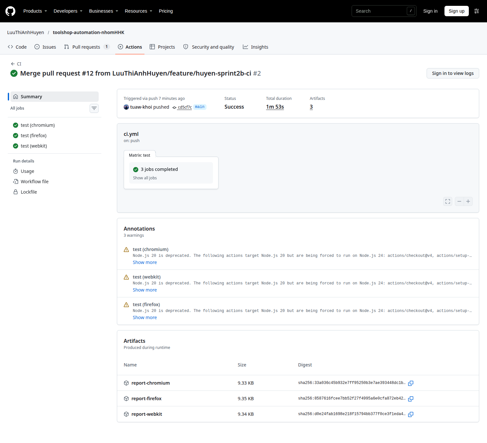
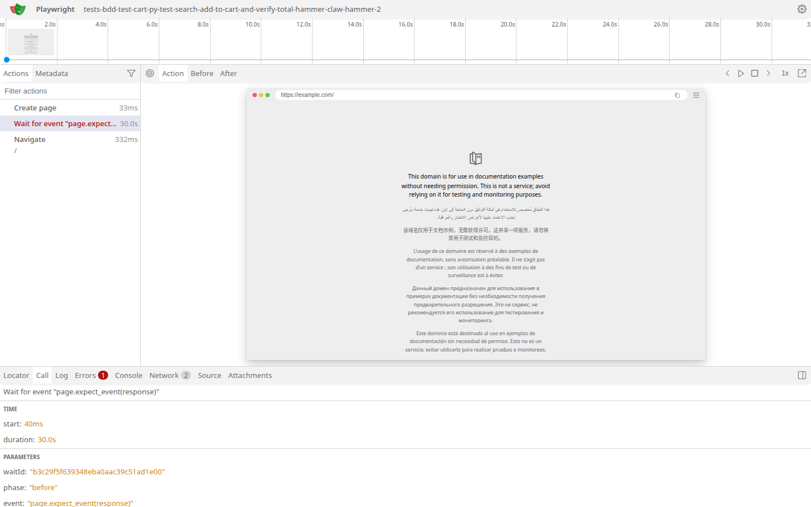

# Toolshop Automation – Nhóm HHK

[](https://github.com/LuuThiAnhHuyen/toolshop-automation-nhomHHK/actions/workflows/ci.yml)

Bộ kiểm thử tự động cho Toolshop, sử dụng Python, pytest và Playwright.

## Chạy kiểm thử

Sao chép file cấu hình mẫu, sau đó cài thư viện và trình duyệt Playwright:

```bash
cp .env.example .env
python -m venv .venv
source .venv/bin/activate
pip install -r requirements.txt
playwright install
pytest -v
```

Chạy riêng feature BDD:

```bash
pytest tests/bdd -v
```

## Kết quả CI

[Lượt CI trên main sau khi merge PR #12](https://github.com/LuuThiAnhHuyen/toolshop-automation-nhomHHK/actions/runs/45337303926) đã thành công trên Chromium, Firefox và WebKit.



## Trace Viewer



Ảnh Trace Viewer minh họa một lần chạy local với `BASE_URL=https://example.com` để tạo lỗi cấu hình có kiểm soát. Bước chờ phản hồi danh sách sản phẩm bị timeout; đây không phải lỗi của lượt CI xanh phía trên.

## Nghiệm thu Sprint 2B

1. Mở Actions và trình bày lượt chạy trên `main` xanh đủ ba trình duyệt.
2. Mở README để xem badge CI và hai ảnh minh chứng.
3. Trưởng nhóm kiểm tra luật bảo vệ `main`: yêu cầu một approval và ba required status checks `test (chromium)`, `test (firefox)`, `test (webkit)`.
4. Chạy `pytest tests/bdd -v` để trình bày kết quả Scenario Outline.

Không commit `.env`, `.venv/`, `__pycache__/`, `test-results/` hoặc `report*.html`; chỉ lưu ảnh minh chứng trong `docs/screenshots/`.
